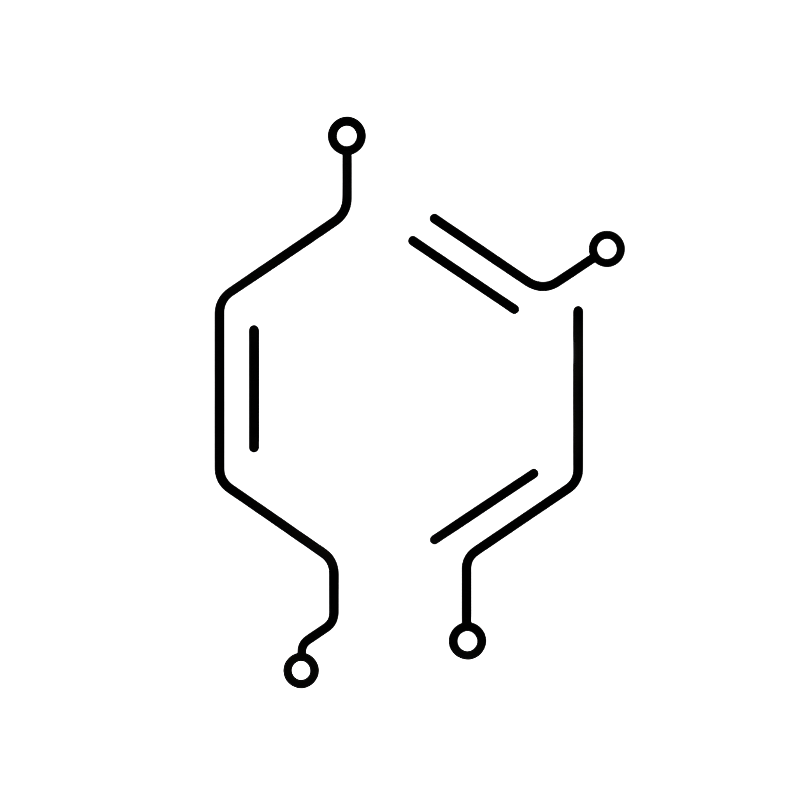
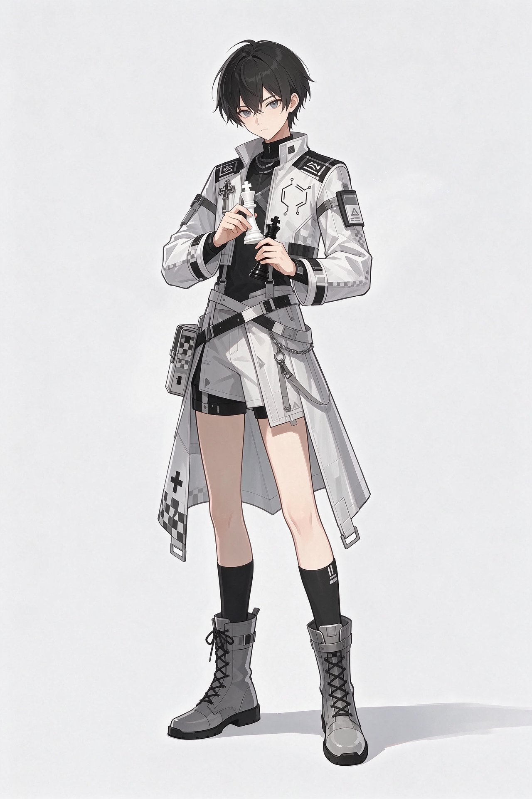

# Benzene-0.2-Phenol



**Chess neural network · 15.72M parameters · trained from scratch**

Benzene-0.2 is the chess line of the Benzene series. 0.2 uses chemical molecule
names, where each molecule is an independent model variant with its own
playing personality.

<br clear="left"/>

| Variant | Chemistry | Role | Params | Status |
|---|---|---|---|---|
| [Alkane](https://github.com/Benzene-AI-Lab/Benzene-0.2-Alkane) | Saturated single bonds | Stable baseline | 6.85M | ✅ |
| Alkene | Reactive double bonds | Deep search | 132.82M | Awaiting data |
| Alkyne | High-energy triple bonds | Aggressive | derived | Planned |
| **Phenol** | Aromatic parent structure | Strongest | **15.72M** | ✅ This release |

**Phenol is the strongest variant currently released.**

---

## What this is

An AlphaZero-style chess neural network. Given a position it outputs:

- **policy** — a probability distribution over 4,672 moves
- **value** — win probability for the side to move, in [-1, 1]

Pair it with MCTS to play.

Estimated strength is around **1540–1560 Elo**, roughly club level.

---

## Training

**Data**: 3,407,611 positions from three sources

| Source | Positions | Share | Labels |
|---|---|---|---|
| Stockfish 19 self-play | 107,224 | 3.1% | depth 8, MultiPV 3 |
| Master games, parsed | 1,500,251 | 44.0% | human moves, result-weighted value |
| Master games, SF-scored | 1,800,136 | 52.8% | Stockfish eval, MultiPV 3 |

The 24,511 master games come from nine players — Carlsen, Kasparov, Anand,
Kramnik, Aronian, Caruana, Nakamura, Nepomniachtchi and Ding Liren.
458 Freestyle (random-start) games were filtered out.

**Training**: A10 GPU, 20 epochs in 157 minutes

| epoch | val loss | top-1 |
|---|---|---|
| 2 | 2.5301 | 61.1% |
| 8 | 2.2523 | 71.5% |
| **11** | **2.2394** | **73.5%** ← best |
| 20 | 2.3404 | 74.8% |

The model starts to overfit after epoch 11: top-1 keeps climbing while
validation loss turns upward.

---

## Results

Against Stockfish at reduced skill levels, 10 games per level, 800 MCTS
simulations:

| Opponent | Score | Estimated Elo |
|---|---|---|
| Skill 0 (≈1350) | 5W 5D 0L — 75.0% | **1541** |
| Skill 2 (≈1470) | 3W 6D 1L — 60.0% | **1540** |

Two independent levels estimate the same number, which is reassuring.

**Comparison with the previous generation** (6.85M Alkane, trained on 107k
positions only): that model lost all 4 games against Skill 0.

---

## Data made the difference

| Run | Data | val loss | top-1 |
|---|---|---|---|
| Alkane 6.85M | 107k | 3.4607 | 40.5% |
| Phenol (first run) | 107k | 3.5025 | 42.4% |
| **Phenol (this release)** | **3.41M** | **2.2394** | **73.5%** |

Same architecture as the first Phenol run. A 32× increase in data produced a
36% drop in validation loss and a 31-point gain in top-1.

---

## Download weights

Weights are **not** stored in this repository. Download them from the
[Releases](https://github.com/Benzene-AI-Lab/Benzene-0.2-Phenol/releases) page:

```
benzene-0.2-phenol.pt     180 MB
```

Place it under `weights/` before running anything.

---

## Usage

### Play against it

```bash
python src/serve_chess.py --ckpt weights/benzene-0.2-phenol.pt --port 8766
# open http://127.0.0.1:8766
```

Difficulty presets (200 / 800 / 1600 / 3200 MCTS simulations), PGN export
included. A 400-simulation move takes about 25 seconds on a 2-core laptop CPU.

### Use it in a chess GUI (UCI)

`src/uci.py` speaks the UCI protocol, so the engine works in CuteChess, Arena,
Lichess (via lichess-bot), Fritz, ChessBase and anything else that accepts a
UCI engine.

```
Command:  python
Args:     /path/to/src/uci.py --ckpt /path/to/benzene-0.2-phenol.pt --sims 800
```

Or drive it by hand:

```bash
echo -e "uci\nisready\nposition startpos\ngo movetime 1000\nquit" | \
    python src/uci.py --ckpt weights/benzene-0.2-phenol.pt
```

### Call it from Python

```python
import torch, chess
from net import build
from engine import MCTS, pick_move

ck = torch.load("weights/benzene-0.2-phenol.pt", map_location="cpu", weights_only=False)
net = build(ck["config"]["scale"])
net.load_state_dict(ck["model"])
net.eval()

board = chess.Board()
mcts = MCTS(net)
root = mcts.run(board, simulations=800)
_, mv = pick_move(root, temperature=0.0)
print(mv)   # e2e4
```

---

## Architecture

```
Input   19 × 8 × 8 feature planes
          0-5    own   pawn knight bishop rook queen king
          6-11   enemy pawn knight bishop rook queen king
          12-15  castling rights
          16     en-passant target
          17     side to move
          18     move number / 100

Trunk   ResNet, 16 blocks × 192 channels
          stem   Conv3×3(19→192) + BN + ReLU
          block  Conv3×3 → BN → ReLU → Conv3×3 → BN, residual add

policy  Conv1×1(192→16) → FC(1536 → 4672)
value   Conv1×1(192→32) → FC(3072→128) → FC(128→1) → tanh
```

**15,722,849 parameters.**

---

## Known limitations

**1. Still overfits**

Training loss reaches 1.46 while validation bottoms out at 2.24. The ratio is
now about 210 samples per parameter — far better than the 6.8 of the first
run, but still short.

**2. Training stopped early by design**

Epoch 20 reached top-1 74.8% but validation loss had risen to 2.34. The
released checkpoint is epoch 11, the best validation loss.

**3. Evaluation method is imperfect**

Stockfish's `Skill Level` option is not a linear strength control — it
randomises move selection rather than weakening search uniformly. The two
levels that agreed (Skill 0 and 2) do give a consistent estimate, but higher
levels produced inconsistent results and were discarded.

**4. Self-play did not help at this scale**

A 100-game self-play run produced 11,018 positions — 0.3% of the dataset.
Fine-tuning on it made validation loss worse (2.33 vs 2.24). Self-play likely
needs at least a tenfold larger sample to help.

**5. Slow on CPU**

800 simulations take about 50 seconds per move on a 2015 dual-core laptop.
The model was trained on GPU but inference was never optimised.

---

## Move encoding

**Move index 4,672 = 8 × 8 × 73**

73 move types fall into three groups:
- **56 sliding** (rook, bishop, queen): 8 directions × 7 distances
- **8 knight** jumps
- **9 pawn**: forward / double / left-capture / right-capture × 4 promotions
  plus 3 non-promotion types

**Board indexing**: index 0 = a8, 63 = h1 (mirrored relative to python-chess's
a1 = 0, which lays the board out conveniently for convolutions).

**MCTS**: PUCT selection

```
U = c_puct × P × √N_parent / (1 + N_child)
Q is taken from the child's perspective and negated at the parent
c_puct = 1.5
```

---

## Files

```
benzene-0.2-phenol.pt     15.72M params, 180 MB file
src/
├── board.py              board encoding + 4,672-move index
├── net.py                network definitions (four scales)
├── engine.py             MCTS search (PUCT)
├── serve_chess.py        web play interface
├── uci.py                UCI protocol wrapper
├── play.py               random / model matches
├── eval_elo.py           Elo estimation against Stockfish
├── gen_labels.py         Stockfish label generation
├── pgn_to_labels.py      PGN labeling with Stockfish scores
├── pgn_fast.py           PGN parsing without Stockfish
├── train.py              training loop + dataset
└── train_gpu.py          GPU/CPU training entry point
```

---

## License

**CC BY-NC 4.0** — [Attribution-NonCommercial 4.0 International](LICENSE).

### What you may do

- **Share** — copy and redistribute the material in any medium or format
- **Adapt** — remix, transform, and build upon the material
- Use it for research, education, personal learning and evaluation

### What you may not do

- **Use the material for commercial purposes**
- Sublicense the material under different terms

### What you must do

- Give appropriate credit to **CollinsLiu615**
- Link to the license
- Indicate if changes were made

The license covers the model weights, the training pipeline, the logo and the
character illustration (AI-generated with Seedream 5.5).

---

## Artwork



The character illustration is AI-generated with **Seedream 5.5**
(model id `seedream5.5`), depicting the Benzene persona holding white and
black chess pieces.

The logo is a benzene ring drawn in circuit-board style, echoing the
"chemistry" naming convention of the series.

<br clear="right"/>

---

## Acknowledgements

- **Stockfish 19** — training labels and evaluation opponent
- **chessarchive.net** — the 24,511 master games
- **python-chess** — board representation, move generation, PGN handling
- **PyTorch** — trained on a single A10 GPU, inference on CPU
